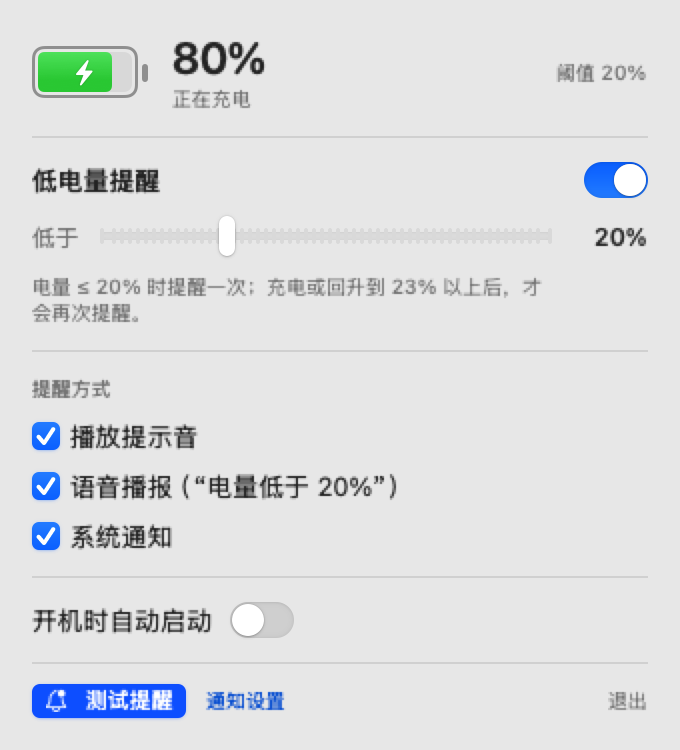

# 电量哨兵 · BatterySentry

> 常驻 macOS 菜单栏的低电量提醒小工具。**但这份 README 的重点不是它本身** —— 而是让你复制一句话，丢给自己的 AI Agent，让它给你从头做一个一模一样的东西。



菜单栏上只有一个手绘的电池图标（不显示百分比）：按电量填充、充电时闪电、低于阈值变红。

---

## 一、复制这句话给你的 Agent

支持 Codex、Claude Code、Trae、Workbuddy、openclaw、Cursor、Cline……任何能在本机跑命令的 Agent。

```
帮我做一个 macOS 原生菜单栏小工具：常驻屏幕右上角，只有一个功能——电池电量低于我设定的阈值时，
播放系统提示音 + 用 macOS TTS 中文语音播报「电量低于 X%」+ 发一条系统原生通知。支持开机自启。

要求：
1. 纯原生 Swift + SwiftUI/AppKit，用 SwiftPM 组织（Package.swift，platform .macOS(.v13)），不要 Electron/Tauri。
2. LSUIElement=true，无 Dock 图标；点击菜单栏图标弹出 NSPopover 面板。
3. 电量用 IOKit 的 IOPSCopyPowerSourcesInfo 读取（Current Capacity / Max Capacity、Is Charging、Power Source State），
   订阅 IOPSNotificationCreateRunLoopSource 电源变化通知，并加 60 秒兜底轮询；不要靠解析 pmset 输出。
4. 菜单栏图标用 Core Graphics 自己画：电池外框 + 按电量比例填充 + 充电时镂空一个闪电 + 低于阈值变红，
   做成 template image 跟随明暗模式；只显示图标，不显示百分比文字。
5. 面板内容：当前电量与充电状态、阈值滑块(5%–60%，默认 20%)、三个提醒渠道开关(提示音/语音/系统通知)、
   开机自启开关、「测试提醒」按钮、退出按钮；偏好存 UserDefaults。
6. 提醒策略：触发后进入已提醒状态，只有充电中或电量回升到「阈值+3%」才重新武装，另加 90 秒最小间隔，避免反复打扰。
7. TTS 用 AVSpeechSynthesizer + AVSpeechSynthesisVoice(language: "zh-CN")，
   文案：「警告，电量已低于百分之20。当前电量12，请尽快连接电源充电。」
   提示音用 NSSound 系统音；通知用 UNUserNotificationCenter，并实现 delegate 让 App 在前台也能弹横幅。
8. 开机自启优先用 macOS 13+ 的 SMAppService.mainApp 注册登录项，失败则退回写
   ~/Library/LaunchAgents/<bundleid>.plist 的 LaunchAgent 兜底，并在界面上提示当前用的是哪种。
9. 写一个 build.sh：swift build --disable-sandbox → 组装 .app bundle（写入 Info.plist、PkgInfo）→
   iconutil 打包图标 → codesign --force --deep --sign - 做 ad-hoc 签名，产出可以直接 open 的 dist/xxx.app。
   再写一个 install.sh 装到 /Applications。
10. 加上 --selftest 命令行参数，能直接打印当前电量读数、阈值、可用的 zh-CN 语音和通知授权状态，方便排查。
```

跑完你会得到：一个能 `open` 的 `.app`、菜单栏图标、一个设置面板，以及三件套提醒。

---

## 二、Agent 大概率会踩的坑（提前告诉它）

| 坑 | 现象 | 正确做法 |
| --- | --- | --- |
| 位图上下文顺序 | 图标很小、挤在按钮左下角 | 先 `rep.size = 26×13`，再 `NSGraphicsContext(bitmapImageRep:)`；顺序反了就是 2x 画布按 1x 画 |
| 菜单栏被管理工具藏起来 | App 明明在跑，但看不到图标 | Ice / Bartender / Hidden Bar 会把新图标塞进隐藏区，让 Agent 打印 `CGWindowListCopyWindowInfo` 的 layer 25 窗口坐标自查（x 为负就是被藏了） |
| 通知权限 | 只响铃不弹横幅 | `UNUserNotificationCenter` 的授权要用户点「允许」；被拒绝过就要去「系统设置 → 通知」手动开 |
| 登录项 | `SMAppService` 报错 | 未公证的 ad-hoc 签名 App 注册登录项常失败，必须有 LaunchAgent 兜底 |
| 前台不显示通知 | 只有切到别的 App 才看到 | 实现 `UNUserNotificationCenterDelegate.willPresent` 返回 `[.banner, .list, .sound]` |
| SwiftPM 沙箱 | `swift build` 报 `sandbox_apply: Operation not permitted` | 在受限环境里加 `--disable-sandbox` |
| 刷屏 | 电量在阈值附近反复响 | 加回差（阈值+3%）+ 最小间隔 |

---

## 三、这个仓库是什么

我（人类）让 Agent 按上面那段提示词做出来的**参考实现**，可以当答案对照，也可以直接用来编译。

```bash
git clone https://github.com/RayMorTwinkle/BatterySentry.git
cd BatterySentry
bash build.sh                 # 编译 + 组装 dist/BatterySentry.app（ad-hoc 签名）
open dist/BatterySentry.app   # 运行
bash install.sh               # 或者：装到 /Applications（登录项更可靠）
```

- 环境：macOS 13+，Xcode Command Line Tools（Swift 6.1 / Xcode 16.4 实测通过）
- 结构：`Sources/BatterySentry/` 按职责拆分 —— BatteryMonitor（IOKit 读数）、AlertCoordinator（何时该响）、Alerter（响什么）、StatusItemController + MenuContentView（界面）、BatteryIcon（图标绘制）、LaunchAtLogin（登录项）
- 自检：

```bash
APP="dist/BatterySentry.app/Contents/MacOS/BatterySentry"
"$APP" --selftest                  # 电量读数 / 阈值 / 中文语音 / 通知授权
"$APP" --selftest --sound --speak  # 顺带试听提示音和语音
"$APP" --snapshot                  # 把设置面板离屏渲染成 PNG
```

### 首次使用注意

1. **图标可能在隐藏区**：装了 Ice 就点 Ice 图标打开 Ice Bar，把电池图标拖到可见区（或按住 `⌘` 拖动）。找不到就自查：
   ```bash
   swift -e 'import CoreGraphics; let ws = CGWindowListCopyWindowInfo([.optionAll], kCGNullWindowID) as! [[String: Any]]; for w in ws where (w["kCGWindowLayer"] as? Int) == 25 { if let o = w["kCGWindowOwnerName"] as? String, o.contains("电量哨兵") { print(o, w["kCGWindowBounds"] ?? "") } }'
   ```
2. **通知权限**：首次运行会请求，允许后才有横幅；拒绝过就到「系统设置 → 通知 → 电量哨兵」打开。
3. **开机自启**：建议先 `bash install.sh` 装到 /Applications，再打开面板里的开关。

---

## 四、功能一览

| 功能 | 说明 |
| --- | --- |
| 低电量提醒 | 电量 ≤ 阈值（默认 20%，可调 5–60%）时触发一次 |
| 提示音 | 系统音 `Sosumi` 连响两次（可关） |
| 语音播报 | zh-CN TTS 念出阈值和当前电量 |
| 系统通知 | 原生横幅，前台也显示 |
| 防刷屏 | 阈值+3% 回差 + 90 秒最小间隔 |
| 菜单栏图标 | 手绘电池：比例填充 / 充电闪电 / 低电量变红 / 明暗自适应 |
| 开机自启 | SMAppService，失败退回 LaunchAgent |

---

## License

MIT，随便用。
